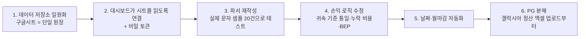

# 🔍 피부과 현금흐름 대시보드 검증 보고서

검토 대상: [clinic_cashflow_dashboard.html](file:///C:/Users/UPIC/.gemini/antigravity/brain/10988b9b-8b7d-4664-89d3-f8199184dbb8/clinic_cashflow_dashboard.html), [public/index.html](file:///C:/Users/UPIC/.gemini/antigravity/scratch/clinic-cashflow-dashboard/public/index.html), [server.py](file:///C:/Users/UPIC/.gemini/antigravity/scratch/clinic-cashflow-dashboard/server.py), [server.js](file:///C:/Users/UPIC/.gemini/antigravity/scratch/clinic-cashflow-dashboard/server.js), [google_sheets_webhook.gs](file:///C:/Users/UPIC/.gemini/antigravity/scratch/clinic-cashflow-dashboard/cloud-deploy/google_sheets_webhook.gs), 그리고 이전 답변에서 드린 설명들.

## 한 줄 결론

> [!IMPORTANT]
> 지금 만들어진 것은 **화면 시안(UI 프로토타입)으로는 잘 나왔지만, 실제 자동화 시스템은 아직 아닙니다.** 이전 답변에서 "구축 완료", "보안 위험 0%"라고 말씀드린 부분은 **과장이었습니다.** 실사용 전에 아래 🔴 항목을 반드시 고쳐야 합니다.

---

## 🔴 1. 치명적 문제 (실사용 불가 수준)

| # | 문제 | 설명 |
|---|---|---|
| 1 | **자동화 흐름이 끊겨 있음** | 폰 → 구글시트(웹훅)로 문자가 저장되더라도, **대시보드가 구글시트를 읽어오는 코드가 없습니다.** 대시보드 숫자는 브라우저 안(localStorage)에만 저장되고, 폰과 PC는 서로 다른 데이터를 보게 됩니다. |
| 2 | **서버가 이 PC에서 실행된 적 없음** | 확인해 보니 이 PC의 `python`은 Microsoft Store 바로가기일 뿐 실제로 설치돼 있지 않고, Node.js도 없습니다. README의 `python server.py` 안내는 지금 상태로는 작동하지 않으며, 서버 코드는 한 번도 테스트되지 않았습니다. |
| 3 | **갤럭시아 PG 분해가 가짜 비율** | "카드 80% / 네이버페이 12% / 카카오페이 8%"는 제가 **임의로 정한 고정 비율**입니다. 실제 분해에 필요한 갤럭시아 가맹점 관리자 데이터 수집 기능은 만들지 않았습니다. 지금 화면의 항목별 수치는 **실제 값이 아닙니다.** |
| 4 | **'받을 정산금'이 고정값** | 1,945만 원이 하드코딩돼 있고, 입금 문자가 와도 줄어들지 않습니다. 단말기 결제 매출을 수집할 데이터 소스도 없습니다. |
| 5 | **날짜 로직 없음** | "11월", "12/14 출금예정", "10/21 기준", 9·10월 손익이 모두 고정 텍스트입니다. 12월이 되면 월 마감, 21일 확정, 카드 회차 초기화가 전혀 동작하지 않습니다. |

## 🔴 2. 보안 · 개인정보 (이전 "보안 이슈 없음" 답변 정정)

| # | 위험 | 설명 |
|---|---|---|
| 1 | **구글 웹훅 `doGet`이 공개됨** | "모든 사용자" 권한으로 배포하면, URL을 아는 **누구나 최근 50건의 입출금 문자 원문을 조회**할 수 있습니다. POST로 가짜 거래를 넣을 수도 있습니다. → 비밀 토큰 검증을 넣고 `doGet`은 삭제해야 합니다. |
| 2 | **문자 전달 앱 권한** | SMS Forwarder 류 앱은 **모든 문자 읽기 권한**을 가집니다. 필터를 잘못 걸면 **인증번호(OTP)·보안 문자까지 외부로 전송**될 수 있습니다. 앱은 신뢰할 수 있는 것을 고르고, 은행·카드 발신번호만 허용하는 화이트리스트로 설정해야 합니다. |
| 3 | **환자 실명 외부 전송** | 하나은행 입금 문자에 찍힌 **환자 이름**이 구글시트에 저장됩니다. 의료기관이라 개인정보보호법상 부담이 있으므로, 이름은 마스킹(예: 김\*\*)해서 저장해야 합니다. |
| 4 | **server.py 무인증** | `/api/reset`은 누구나 호출해 DB를 지울 수 있고, `0.0.0.0` 바인딩에 CORS도 `*`입니다. |
| 5 | **공개 배포 시 접근 제어 없음** | Netlify 주소에 로그인이 없습니다. 실데이터를 연동하면 비밀번호나 접근 제한이 꼭 필요합니다. |

✅ 맞는 부분: 이 구조는 **이체 권한이나 인증서를 쓰지 않으므로 돈이 빠져나가는 사고 위험은 없습니다.** 위험은 **정보 유출** 쪽입니다.

---

## 🟠 3. 손익 계산 로직 오류

1. **수입과 비용의 기준이 섞임**: 수입은 *통장 입금 기준*(10월 말 결제분이 11월 초에 들어온 것 포함)인데, 카드비용은 *승인일 기준*입니다. "1~말일 귀속"이라는 표시와 실제 계산이 다릅니다.
2. **비용 누락**: 20일 재료비 **현금이체 800만 원**과 식대·복리후생·기타(290만 원)가 손익 계산에서 빠져 있습니다. → 순이익이 **과대 표시**되고 있습니다.
3. **손익분기점(BEP) 공식 오류**: 시뮬레이터가 재료비(변동비)를 고정비처럼 더해서 계산합니다. 올바른 공식은 `고정비 ÷ (1 − 변동비율 − 세금적립률)`입니다.
4. **시뮬레이션이 실데이터를 덮어씀**: "대시보드에 적용" 버튼이 실제 매출·비용·BEP를 영구적으로 바꿔 버립니다. 시나리오는 실데이터와 분리해서 저장해야 합니다.
5. **세금 적립 8.5%는 근거 없는 고정값**: 미용 비급여의 부가세 과세 여부, 매입세액 공제, 종합소득세 구간에 따라 크게 달라집니다. 세무사와 상의해 원장님 병원 기준 비율로 설정해야 합니다.
6. **급여 귀속**: 11월 손익에서 11/5에 지급한 급여(=10월 근무분)를 빼고 있습니다. 매달 금액이 비슷하면 큰 문제는 아니지만, 표시 문구는 고쳐야 합니다.

## 🟠 4. 문자 파서 오류 (코드 분석 결과)

| 실제 문자 예시 | 현재 동작 | 문제 |
|---|---|---|
| `[신한카드] 1234 승인 50,000원` | 금액을 **1,234원**으로 인식 (프론트 정규식은 '원'이 선택 사항) | 카드번호 끝 4자리를 금액으로 착각 |
| `[우리은행] 입금 3,200,000원 하나카드` | **하나은행** 입금으로 분류 | "하나" 단어만 보고 은행을 판정 |
| `[신한카드] 승인취소 1,850,000원` | **지출로 추가** | 취소·환불 처리 없음 |
| `잔액 55,380,000원` 포함 문자 | 프론트는 잔액 무시하고 금액만 더함 | 시간이 지날수록 잔액 오차 누적 (서버 코드는 잔액 반영 → 서로 불일치) |
| 하나→우리 내부이체 (실제로는 **출금 문자 + 입금 문자 2건**) | 1건마다 양쪽 잔액을 모두 이동 | **이중 이동**; 실제 문자에는 "집금"이 아니라 원장님/병원 이름이 찍힘 |
| 우리WON 등 **앱 푸시 알림** | 처리 불가 | 요즘 은행은 SMS 대신 앱 푸시를 보내는 경우가 많아, 알림 접근 권한 방식이 필요할 수 있음 |

추가: 문자 내용을 `innerHTML`로 화면에 넣고 있어 이론상 스크립트 삽입(XSS) 위험이 있습니다.

## 🟡 5. 기타

- `public/index.html`이 Antigravity **미리보기 전용 Tailwind 주소**(`gstatic.com/antigravity/web/dev/...`)를 쓰고 있습니다. 실제 배포에서는 정식 CSS로 바꿔야 합니다.
- `server.js`는 Node가 없어 쓰지 않는 중복 파일입니다.
- 이전 답변의 **"국내 거의 모든 카드사는 14일 출금 = 전월 1일~말일"은 지나친 일반화**였습니다. 카드사마다 다르니 경남BC와 14일 카드 모두 **카드 명세서의 이용기간으로 확인**하시길 권합니다.
- 샘플 숫자 사이에 앞뒤가 안 맞는 부분이 있습니다 (예: 9/21 2,840만 → 10/21 8,120만 급증).

---

## ✅ 잘된 점 (유지할 것)

- **매월 21일 공식 기준일**, 5·10·14·20일 출금 릴레이, 귀속 월 기준 손익이라는 **설계 방향은 타당**합니다.
- 통장 3개 역할 분리(우리=정산·출금 / 하나=현금 / 경남=플랫폼)를 활용한 **입금자명 기반 분류 아이디어**는 실용적입니다.
- 카드 **승인일 기준 비용 인식 + 출금일 D-Day** 구조, 폴드5 접은 화면 레이아웃, What-If 시뮬레이터 UX는 잘 만들어졌습니다.

---

## 🛠️ 권장 수정 순서

> [!TIP]
> 3번에서 가장 중요한 준비물은 **원장님 폰에 실제로 오는 은행·카드 문자 원문**입니다(우리·하나·경남 입출금, 14일·20일 카드 승인/취소, 갤럭시아·강남언니 입금 각 2~3건). 금액과 이름은 가리셔도 됩니다. 이걸로 파서를 맞추면 정확도가 크게 올라갑니다.
